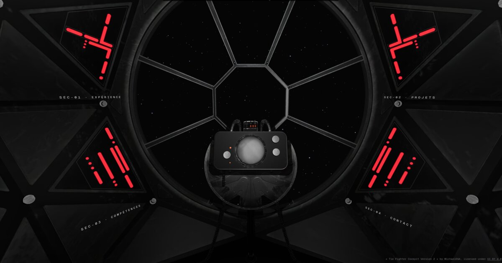

# Portfolio : Louis OLIVIER

Portfolio personnel en forme de **cockpit de TIE Fighter en 3D** : le visiteur est assis aux commandes et découvre chaque section (expérience, projets, compétences, contact) sur les panneaux autour du hublot.



- **Cockpit 3D** : `/` (français) et `/en` (anglais)
- **Version classique** (2D, accessible) : `/classique` et `/en/classique`

## Dans le cockpit

- **Panneaux latéraux** : un clic rapproche la caméra et ouvre la section. Échap ou le bouton « Vue d'ensemble » ramène face au hublot.
- **Console centrale** :
  - l'écran rond affiche ou cache la carte de présentation ;
  - le bouton de gauche déclenche l'alerte rouge ;
  - le bouton en haut à droite projette un hologramme du pilote (la carte et l'hologramme ne s'affichent jamais ensemble).
- **Sons** sur les interactions, coupables avec le bouton haut-parleur (choix mémorisé).
- **Mobile** : barre de sections en bas de l'écran, contenu dans un panneau qui glisse, modèle 3D allégé.
- **Mode dégradé** : les appareils trop modestes (sans WebGL, peu de mémoire…) sont redirigés vers la version classique. Si l'affichage devient saccadé, la résolution baisse puis la version classique est proposée.
- `prefers-reduced-motion` respecté : transitions de caméra et effets sans animation.

## Stack

Next.js 16 (App Router, Turbopack) · React 19 · TypeScript · Tailwind CSS · three.js · React Three Fiber 9 · drei 10 · ESLint 9

Hébergé sur Vercel, déployé automatiquement depuis `main`.

## Lancer le projet

```bash
npm install
npm run dev     # http://localhost:3000
npm run build   # build de production
npm run lint    # ESLint
```

## Modifier le contenu

| Quoi | Où |
|------|----|
| Textes (FR / EN) | `app/_data/content.fr.ts`, `app/_data/content.en.ts` (mêmes clés) |
| Liens, tags, dates, icônes | `app/_data/portfolio.tsx` |
| Profils GitHub / LinkedIn | `app/_data/profiles.ts` |
| CV | `public/cv-louis-olivier.pdf` |
| Sons | `public/sounds/` (voir le README du dossier) |
| Hologramme | `public/hologram/pilot.webp`, recadré depuis `assets/hologram/` (changer le nom du fichier si l'image change, à cause du cache des navigateurs) |
| Aperçu de partage | `public/og-image.jpg` (1200 × 630) |

Le contenu alimente à la fois le cockpit, la version classique et la version texte destinée aux moteurs de recherche et aux lecteurs d'écran.

## Structure

```
app/
  (fr)/, (en)/        pages et mise en page racine de chaque langue
  _components/        page classique, version texte, composants partagés
  _data/              contenu, langues, métadonnées (SEO, aperçu de partage)
components/three/     scène 3D : cockpit, caméra, panneaux, cartes, starfield, hologramme…
assets/               fichiers sources non publiés (modèle 3D d'origine, photo de l'hologramme, captures)
public/               fichiers servis : modèles optimisés, décodeur Draco, sons, hologramme, CV
```

## Crédits

Modèle 3D : « Tie Fighter Cockpit Version 2 » by MichaelEGA, licensed under [CC BY 4.0](https://creativecommons.org/licenses/by/4.0/).

Projet personnel et non commercial, inspiré de l'univers Star Wars, sans lien avec Lucasfilm ni Disney.
